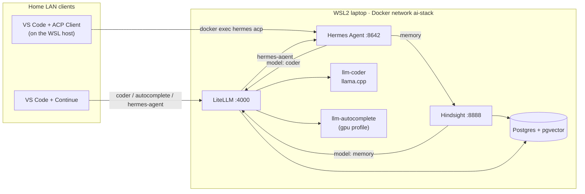

# ai-stack

A self-hosted AI-assisted development stack, made only of Docker containers, for VS Code. It runs in **WSL2 on a laptop with 16 CPU / 32 GB RAM / an NVIDIA Blackwell 8 GB GPU**, and is reachable **only from your home LAN**.

There are two standalone Compose files, each selected by a profile:

| Profile | Compose file | Coding model | When |
|---|---|---|---|
| **`gpu`** (default) | `docker-compose.gpu.yml` | Qwen3-Coder-30B-A3B on GPU + RAM, plus a 1.5B autocomplete model on the GPU | normal use |
| **`cpu`** | `docker-compose.cpu.yml` | the same model (Q3) on CPU + RAM; the local model is optional (`--local-model off`) | CPU vs. GPU comparison, GPU busy, or on battery |

The profile writes the right Compose file into `.env` (`COMPOSE_FILE`), so a plain `docker compose ...` always uses it. The shared services are identical in both files, and `scripts/check-compose.sh` verifies that.

| Layer | Component | Role |
|---|---|---|
| Orchestration and memory | **[Hermes Agent](https://github.com/NousResearch/hermes-agent)** (Nous Research) | Agent loop, tools (files, terminal, web), skills that improve with use, session history, ACP for editors |
| Long-term memory | **[Hindsight](https://github.com/vectorize-io/hindsight)** (Hermes memory provider) | Fact and entity extraction, semantic recall and reflection, stored in Postgres + pgvector |
| Routing and management | **[LiteLLM](https://github.com/BerriAI/litellm) proxy** | One OpenAI-compatible endpoint, model aliases, per-user virtual keys, rate limits, usage logs, optional cloud fallback |
| Local models | **llama.cpp server** (CPU or CUDA) | `coder` / `autocomplete` / `memory` routes. Model choice per profile: [docs/models.md](docs/models.md) |
| Persistence | **PostgreSQL 17 + pgvector** | LiteLLM (keys, spend, logs) and Hindsight (memories, embeddings) |



**Design choices**

- **Everything that calls a model goes through LiteLLM.** That covers Hermes, Hindsight and the editors. You get one place to swap models, add a cloud fallback, set limits, and see who used what.
- **Hermes is also a "model" in LiteLLM** (`hermes-agent`). A LAN client needs one URL and one key, and can pick the raw model for speed or the agent for multi-step work.
- **Home LAN only.** Two ports are published, `4000` (LiteLLM) and `8642` (Hermes, optional). `windows/setup-lan.ps1` opens them in the Windows and Hyper-V firewalls to the home LAN subnet only, on the Private profile. Postgres and Hindsight's UI stay on `127.0.0.1`. The model servers publish no ports.
- **The workspace is mounted at the same path** inside Hermes, so paths in the agent's output match VS Code.
- **Hard resource limits.** Every service except the coding model is capped, together within 4 CPU / 7 GB. The coding model is the one service allowed to use more. `scripts/doctor.sh` checks this. Details: [docs/resources.md](docs/resources.md).

## Requirements

- Windows 11 22H2+ with WSL2 (Ubuntu 24.04); Docker Engine in WSL (recommended) or Docker Desktop
- NVIDIA Blackwell GPU (8 GB), Windows driver ≥ R570, NVIDIA Container Toolkit in WSL
- 16 CPU / 32 GB RAM. The WSL VM gets 14 CPU / 24 GB (`windows/wslconfig.example`)
- ~35 GB disk for images and models
- On the WSL side only **bash + Docker**. Everything else, including the HTTP calls the scripts make, runs in containers.

Step-by-step: **[docs/setup-wsl.md](docs/setup-wsl.md)**

## Quick start

```bash
# in the Ubuntu (WSL) terminal — not PowerShell, not under /mnt/c
cd ~ && git clone https://github.com/wyhitomi/ai-stack.git && cd ~/ai-stack
scripts/install-docker-wsl.sh              # Docker + NVIDIA toolkit (once; may ask for `wsl --shutdown`)
scripts/bootstrap.sh                       # gpu profile (or: --profile cpu)
docker compose logs -f llm-coder           # first start downloads the model (~19 GB)
scripts/doctor.sh                          # budget + every hop + a real inference
```

`bootstrap.sh` generates secrets, applies the profile, starts the services in order, creates the LiteLLM virtual keys and installs Hermes' memory plugin. It's safe to re-run.

Then:

1. **Home LAN access.** Run `windows\setup-lan.ps1` as Administrator, then `wsl --shutdown` ([guide](docs/setup-wsl.md#4-home-lan-access-and-nothing-else)).
2. **VS Code.** Copy `vscode/continue-config.yaml` to `~/.continue/config.yaml` and fill in the host and key ([docs/vscode.md](docs/vscode.md)).
3. **Hermes CLI** (optional): `docker exec -it hermes hermes` opens the full terminal UI.

## Endpoints

| URL | Who | Auth |
|---|---|---|
| `http://<laptop-lan-ip>:4000/v1` | VS Code / any OpenAI client on the home LAN | LiteLLM virtual key |
| `http://localhost:4000/ui` | you (admin UI: keys, usage, logs) | `LITELLM_UI_USERNAME` / `LITELLM_UI_PASSWORD` |
| `http://<laptop-lan-ip>:8642/v1` | direct Hermes API (model `hermes-agent`) | `HERMES_API_KEY` |
| `http://localhost:9999` | Hindsight UI (browse and fix memories) | — (local only) |
| `127.0.0.1:5432` | psql / DBeaver | `postgres` / `POSTGRES_PASSWORD` |

Models exposed by LiteLLM: `coder`, `autocomplete`, `memory` (used internally by Hindsight), `hermes-agent`.

## How memory works

Hermes keeps three layers, all on disk under `data/`:

1. **Session history and built-in memory**: Hermes' own SQLite `state.db`, plus memory and skill files in `data/hermes`. This holds conversations, full-text session search, and skills Hermes writes itself.
2. **Long-term semantic memory**: Hindsight, in Postgres (`hindsight` DB). After each turn Hermes retains facts and decisions. Before each turn it recalls the relevant ones. It also has `hindsight_recall` / `hindsight_reflect` tools. Memory bank: `dev` (`data/hermes/hindsight/config.json`).
3. **Usage and audit**: LiteLLM, in Postgres (`litellm` DB). This stores who called which model, latency and tokens. Prompt bodies are **not** stored by default (`store_prompts_in_spend_logs: false`).

## Day-to-day

```bash
docker compose ps                      # status
docker compose logs -f hermes          # follow a service
scripts/new-key.sh laptop-ana          # key for another machine/person
docker compose pull && docker compose up -d   # upgrade (pin digests in .env once stable)
```

**Swap the model:** edit `profiles/<profile>/llm-coder.env`, then `docker compose up -d llm-coder` ([docs/models.md](docs/models.md)).

**Switch profile:** `docker compose down && scripts/bootstrap.sh --profile cpu` (or `gpu`). It re-applies the budgets and Compose file and keeps your secrets, keys and data.

**Cloud fallback:** uncomment `cloud-coder` and `fallbacks` in `litellm/config.yaml`, set the key in `.env`, then `docker compose up -d litellm`.

**Backup:**

```bash
docker exec ai-postgres pg_dumpall -U postgres | gzip > backup-$(date +%F).sql.gz
docker exec hermes hermes backup        # Hermes' own snapshot (never copy state.db by hand)
```

## Security notes

- **Hermes runs shell commands** inside its container, with your workspace mounted read-write. Anyone holding `HERMES_API_KEY`, or a LiteLLM key allowed to use `hermes-agent`, can act on that code. Treat those keys like SSH access to the repo.
- For a tighter setup, set `HERMES_BIND=127.0.0.1` in `.env`. LAN clients still reach Hermes through LiteLLM, with per-user keys that you can revoke.
- `LITELLM_MASTER_KEY` is the admin key. It stays on the laptop. Give other machines virtual keys only (`scripts/new-key.sh`).
- The firewall rules are limited to the **home LAN subnet** and the **Private** network profile. On other networks (café, office) nothing is reachable from outside. Never forward 4000 or 8642 on your router.
- `LITELLM_SALT_KEY` encrypts credentials stored in the DB. Changing it after the first run makes them unreadable.

## Layout

```
docker-compose.gpu.yml    full stack, NVIDIA GPU, Blackwell-ready (profile gpu, default)
docker-compose.cpu.yml    full stack, CPU only, optional local model (profile cpu)
profiles/{gpu,cpu}/       stack.env (budget, binds, compose file) + llm-*.env (model tuning)
.env.example              shared settings + secrets (bootstrap.sh → .env)
litellm/config.yaml       model routes, fallbacks, logging
postgres/init/            first-boot DB/role/extension setup
hermes/                   Hermes config template + Hindsight plugin config
scripts/                  install-docker-wsl, bootstrap, doctor (health + budget), new-key, check-compose
windows/                  .wslconfig + home-LAN firewall script (PowerShell)
vscode/                   Continue config, ACP settings
docs/                     setup-wsl, models, resources, vscode
CONTRIBUTING.md           Conventional Commits + branch naming (hook: .githooks/commit-msg)
CLAUDE.md                 the same rules for AI coding assistants
LICENSE                   BSD 3-Clause
data/                     runtime state (git-ignored)
```

## Contributing

Commits follow [Conventional Commits](https://www.conventionalcommits.org). Branches are named `<type>/<short-description>`, and every change reaches `main` through a pull request. See [CONTRIBUTING.md](CONTRIBUTING.md). To enforce the format locally:

```bash
git config core.hooksPath .githooks
```

## License

[BSD 3-Clause](LICENSE). The components the stack pulls (Hermes Agent, LiteLLM, llama.cpp, Hindsight, PostgreSQL, and the model weights) keep their own licenses.
