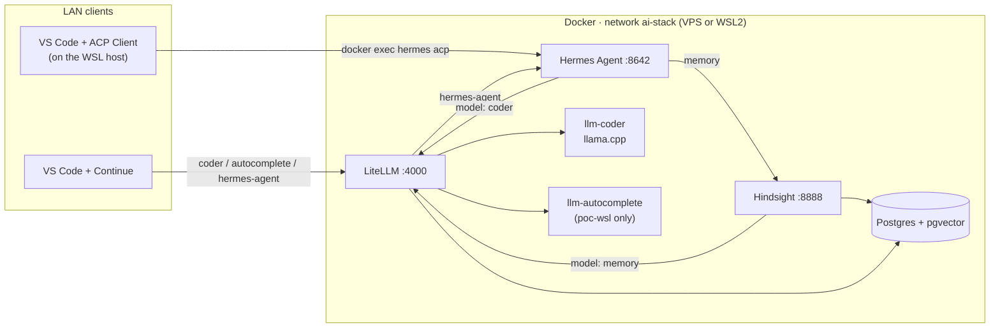

# ai-stack

A self-hosted AI-assisted development stack, made only of Docker containers, for VS Code. It targets two machines with the same compose files and different profiles:

| Profile | Machine | Model for `coder` | Purpose |
|---|---|---|---|
| **`vps`** | 4 vCPU / 8 GB RAM, no GPU | Qwen2.5-Coder-1.5B on CPU | production. **Everything**, model included, fits in 8 GB |
| **`poc-wsl`** | WSL2 · 16 CPU / 32 GB · Blackwell 8 GB | Qwen3-Coder-30B-A3B, GPU + RAM | proof of concept, reachable over the LAN |
| **`poc-wsl-cpu`** | same WSL box, GPU unused | Qwen3-Coder-30B-A3B (Q3), CPU + RAM | CPU-vs-GPU comparison, or a fallback when the GPU is busy |

There are two standalone Compose files: **`docker-compose.cpu.yml`** (used by `vps` and `poc-wsl-cpu`) and **`docker-compose.gpu.yml`** (used by `poc-wsl`). **In the CPU file the local model is optional:** `scripts/bootstrap.sh --local-model off` routes every model call to a remote GPU host or a hosted provider instead ([how](docs/deploy-vps.md#running-without-a-local-model)). The profile writes the right one into `.env` (`COMPOSE_FILE`), so a plain `docker compose ...` always uses it. To run a file directly: `docker compose -f docker-compose.gpu.yml up -d`. The shared services are kept identical in both files, and `scripts/check-compose.sh` verifies that.

The PoC runs every non-model service with **the VPS limits**, so a working PoC shows the stack fits the VPS. Only the model differs.

| Layer | Component | Role |
|---|---|---|
| Orchestration and memory | **[Hermes Agent](https://github.com/NousResearch/hermes-agent)** (Nous Research) | Agent loop, tools (files, terminal, web), skills that improve with use, session history, ACP for editors |
| Long-term memory | **[Hindsight](https://github.com/vectorize-io/hindsight)** (Hermes memory provider) | Fact and entity extraction, semantic recall and reflection, stored in Postgres + pgvector |
| Routing and management | **[LiteLLM](https://github.com/BerriAI/litellm) proxy** | One OpenAI-compatible endpoint, model aliases, per-user virtual keys, rate limits, usage logs, optional cloud fallback |
| Local models | **llama.cpp server** (CPU or CUDA) | `coder` / `autocomplete` / `memory` routes. Model choice per profile: [docs/models.md](docs/models.md) |
| Persistence | **PostgreSQL 17 + pgvector** | LiteLLM (keys, spend, logs) and Hindsight (memories, embeddings) |



**Design choices**

- **Everything that calls a model goes through LiteLLM.** That covers Hermes, Hindsight and the editors. You get one place to swap models, add a cloud fallback, set limits, and see who used what.
- **Hermes is also a "model" in LiteLLM** (`hermes-agent`). A LAN client needs one URL and one key, and can pick the raw model for speed or the agent for multi-step work.
- **Only two ports are ever published:** `4000` (LiteLLM) and `8642` (Hermes, optional). On the PoC they're open to the LAN; on the VPS they're bound to the Tailscale IP or `127.0.0.1`, never the public interface. Postgres, the model servers and Hindsight stay internal.
- **The workspace is mounted at the same path** inside Hermes, so paths in the agent's output match VS Code.
- **Hard resource limits on every container.** On the VPS, memory limits add up to 7.4 GB including the model, leaving ~0.8 GB for the OS. On the PoC, the same limits apply to everything except the model. `scripts/doctor.sh` checks this. Details: [docs/resources.md](docs/resources.md).
- **The model behind `coder` is swappable with one line.** The VPS can route `coder` to a GPU host (like the PoC machine, over Tailscale) and keep the small local model for autocomplete and memory.

## Requirements

On the host you only need **bash + Docker** (Engine with the compose plugin). Everything else, including the HTTP calls the scripts make, runs in containers.

| | `vps` | `poc-wsl` |
|---|---|---|
| OS | Ubuntu 24.04 / Debian 12 | Windows 11 + WSL2 (Ubuntu 24.04) |
| CPU / RAM | 4 vCPU / 8 GB | 16 CPU / 32 GB (WSL VM: 14 / 26 GB) |
| GPU | none | NVIDIA Blackwell 8 GB, Windows driver ≥ R570 + NVIDIA Container Toolkit |
| Disk | ~15 GB | ~35 GB |
| Guide | **[docs/deploy-vps.md](docs/deploy-vps.md)** | **[docs/deploy-poc-wsl.md](docs/deploy-poc-wsl.md)** |

## Quick start

```bash
git clone <this repo> ~/ai-stack && cd ~/ai-stack
scripts/bootstrap.sh --profile poc-wsl     # or: poc-wsl-cpu, vps  [--local-model off]
docker compose logs -f llm-coder           # first start downloads the model
scripts/doctor.sh                          # budget + every hop + a real inference
```

`bootstrap.sh` generates secrets, applies the profile, starts the services in order, creates the LiteLLM virtual keys and installs Hermes' memory plugin. It's safe to re-run.

Then:

1. **Network.** PoC: run `windows\setup-lan.ps1` as Administrator, then `wsl --shutdown` ([guide](docs/deploy-poc-wsl.md#4-make-it-reachable-from-the-lan)). VPS: Tailscale or an SSH tunnel ([guide](docs/deploy-vps.md#network-never-on-the-public-interface)).
2. **VS Code.** Copy `vscode/continue-config.yaml` to `~/.continue/config.yaml` and fill in the host and key ([docs/vscode.md](docs/vscode.md)).
3. **Hermes CLI** (optional): `docker exec -it hermes hermes` opens the full terminal UI.

## Endpoints

| URL | Who | Auth |
|---|---|---|
| `http://<host>:4000/v1` | VS Code / any OpenAI client | LiteLLM virtual key |
| `http://localhost:4000/ui` | you (admin UI: keys, usage, logs) | `LITELLM_UI_USERNAME` / `LITELLM_UI_PASSWORD` |
| `http://<host>:8642/v1` | direct Hermes API (model `hermes-agent`) | `HERMES_API_KEY` |
| `http://localhost:9999` | Hindsight UI (browse and fix memories) | — (local only) |
| `127.0.0.1:5432` | psql / DBeaver | `postgres` / `POSTGRES_PASSWORD` |

Models exposed by LiteLLM: `coder`, `autocomplete`, `memory` (used internally by Hindsight), `hermes-agent`.

## How memory works

Hermes keeps three layers, all on disk under `data/`:

1. **Session history and built-in memory**: Hermes' own SQLite `state.db`, plus memory and skill files in `data/hermes`. This holds conversations, full-text session search, and skills Hermes writes itself.
2. **Long-term semantic memory**: Hindsight, in Postgres (`hindsight` DB). After each turn Hermes retains facts and decisions. Before each turn it recalls the relevant ones. It also has `hindsight_recall` / `hindsight_reflect` tools. Memory bank: `dev` (`data/hermes/hindsight/config.json`).
3. **Usage and audit**: LiteLLM, in Postgres (`litellm` DB). This stores who called which model, latency and tokens. Prompt bodies are **not** stored by default (`store_prompts_in_spend_logs: false`).

## Day-to-day

```bash
docker compose ps                      # status
docker compose logs -f hermes          # follow a service
scripts/new-key.sh laptop-ana          # key for another machine/person
docker compose pull && docker compose up -d   # upgrade (pin digests in .env once stable)
```

**Swap the model:** edit `profiles/<profile>/llm-coder.env`, then `docker compose up -d llm-coder` ([docs/models.md](docs/models.md)).

**Switch profile:** `scripts/bootstrap.sh --profile <name>`. It re-applies the budgets and overrides and keeps your secrets and keys.

**Cloud fallback:** uncomment `cloud-coder` and `fallbacks` in `litellm/config.yaml`, set the key in `.env`, then `docker compose up -d litellm`.

**Backup:**

```bash
docker exec ai-postgres pg_dumpall -U postgres | gzip > backup-$(date +%F).sql.gz
docker exec hermes hermes backup        # Hermes' own snapshot (never copy state.db by hand)
```

## Security notes

- **Hermes runs shell commands** inside its container, with your workspace mounted read-write. Anyone holding `HERMES_API_KEY`, or a LiteLLM key allowed to use `hermes-agent`, can act on that code. Treat those keys like SSH access to the repo.
- For a tighter setup, set `HERMES_BIND=127.0.0.1` in `.env`. LAN clients still reach Hermes through LiteLLM, with per-user keys that you can revoke.
- `LITELLM_MASTER_KEY` is the admin key. It stays on the server. Give clients virtual keys only.
- PoC: the firewall rules are limited to the **Private** network profile and the **local subnet**. Never port-forward 4000 or 8642 on your router.
- VPS: nothing listens on the public interface. Docker bypasses ufw, so the bind address (`LAN_BIND`) is the real protection. Use Tailscale or an SSH tunnel.
- `LITELLM_SALT_KEY` encrypts credentials stored in the DB. Changing it after the first run makes them unreadable.

## Layout

```
docker-compose.cpu.yml    full stack, CPU only (vps, poc-wsl-cpu)
docker-compose.gpu.yml    full stack, NVIDIA GPU, Blackwell-ready (poc-wsl)
profiles/<name>/          stack.env (budget, binds, overrides) + llm-*.env (model tuning)
.env.example              shared settings + secrets (bootstrap.sh → .env)
litellm/config.yaml       model routes, fallbacks, logging
postgres/init/            first-boot DB/role/extension setup
hermes/                   Hermes config template + Hindsight plugin config
scripts/                  bootstrap, doctor (health + budget), new-key, check-compose (cpu/gpu parity)
windows/                  PoC: .wslconfig + LAN firewall script (PowerShell)
vscode/                   Continue config, ACP settings
docs/                     deploy-vps, deploy-poc-wsl, models, resources, vscode
LICENSE                   BSD 3-Clause
data/                     runtime state (git-ignored)
```

## License

[BSD 3-Clause](LICENSE). The components the stack pulls (Hermes Agent, LiteLLM, llama.cpp, Hindsight, PostgreSQL, and the model weights) keep their own licenses.
